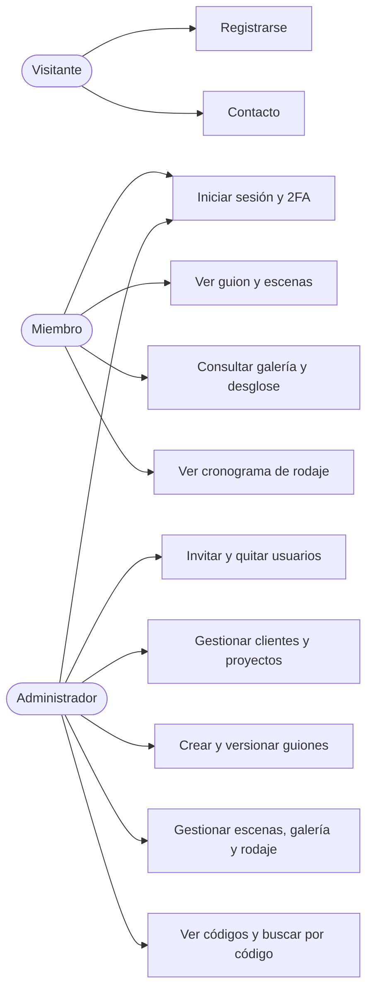
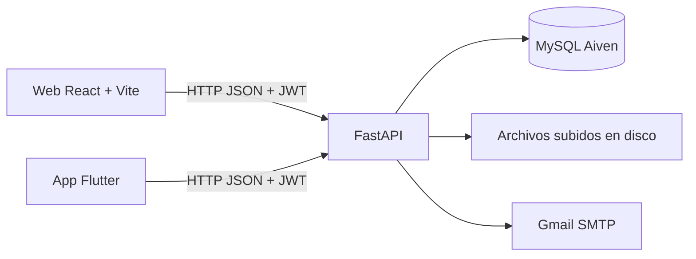
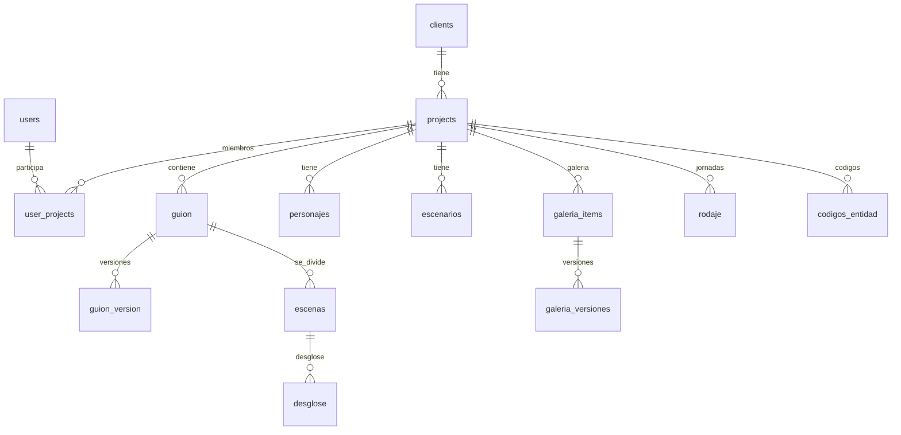
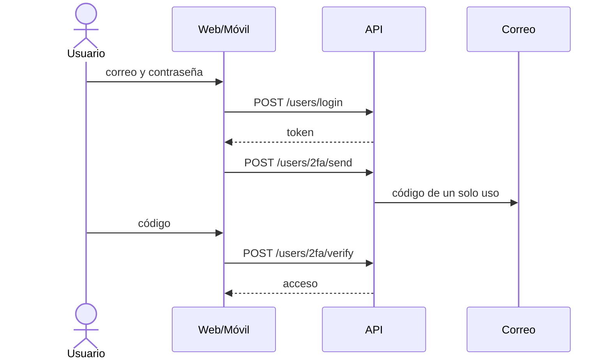
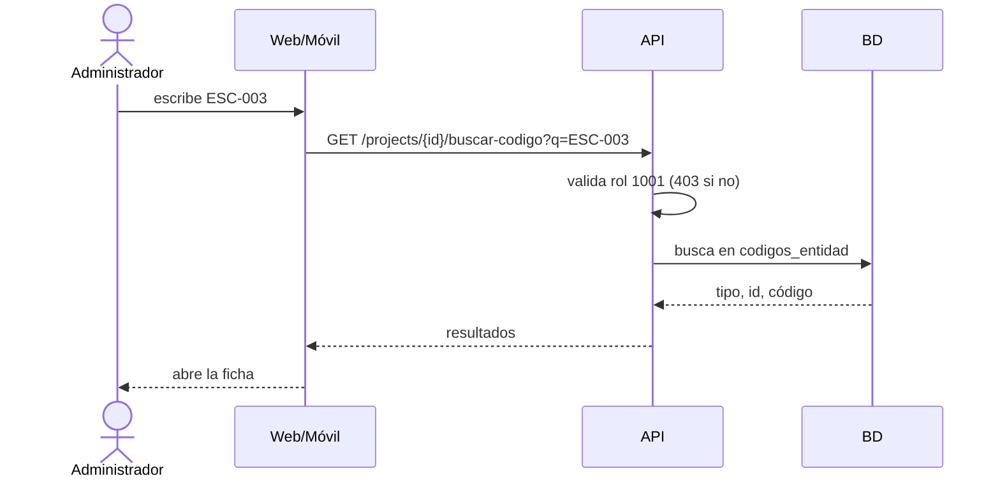

# Diagramas

Todos en Mermaid: GitHub los dibuja solo.

## Casos de uso

## Arquitectura

## Entidad-relación (simplificado)

## Secuencia: inicio de sesión con 2FA

## Secuencia: buscar por código (admin)

