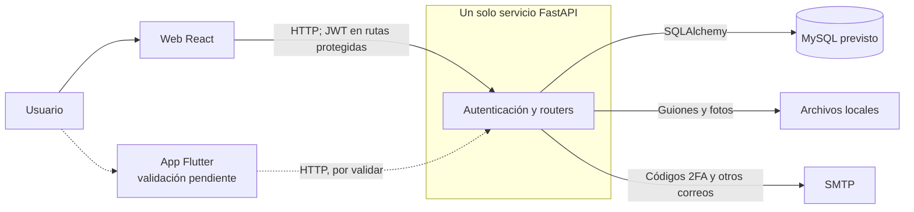
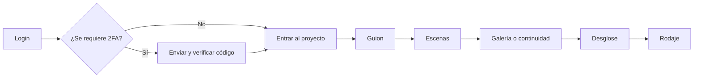

# Sustentación T6 — FOCCUS

Resumen del equipo para preparar la exposición; la calificación corresponde al instructor. Las pruebas registradas son parciales: no se ha demostrado una demo completa de inicio a fin.

## Matriz de estado y evidencia

| # | Criterio | Estado | Evidencia breve y qué falta |
|---|---|---|---|
| 01 | Cierre T6 y orientación T7 | ✅ | Cierre del desarrollo web; las pantallas de [guion](https://github.com/Cr4ckJu4nF3/FOCCUS/blob/02ffb2de7c123b5b228aa2e2df9298faf4278eca/frontend/src/screen/Guion.jsx) y [proyecto](https://github.com/Cr4ckJu4nF3/FOCCUS/blob/02ffb2de7c123b5b228aa2e2df9298faf4278eca/frontend/src/screen/ProjectDashboard.jsx) muestran módulos, no una demo completa. Móvil continúa pendiente. |
| 02 | Retrospectivas | ⏸ En proceso | Faltan dos retrospectivas reales con reflexión sobre las pruebas. |
| 03 | Backend funcional y responsabilidades | ✅ | FOCCUS utiliza **un servicio FastAPI** y organiza sus funciones en routers (usuarios, proyectos, guion, escenas, galería y rodaje). El [arranque probado](https://github.com/Cr4ckJu4nF3/FOCCUS/blob/docs/t6-evidencia-20261121/docs/agentes/T6_EVIDENCIA.md#ejecución-y-límites) fue simulado. La interpretación del criterio la valida el instructor. |
| 04 | JWT, validación e instalación | 🟡 Parcial | ✅ JWT y validaciones: 27 pruebas aisladas. 🟡 Instalación desde cero y login completo con 2FA: no comprobados. |
| 05 | Arquitectura y recorrido integral | 🟡 Parcial | El diagrama se contrastó con rutas y pantallas. La demo completa con API y persistencia no está probada. |
| 06 | Bonificación IoT | ➖ No se realiza | Decisión del equipo; no se presenta un prototipo. |
| 07 | Plan de pruebas | ✅ | [Plan aprobado por el usuario](plan-pruebas.md); aprobar el plan no significa que se hayan ejecutado todos los casos. |
| 08 | Casos de prueba | ✅ | 27 casos de seguridad y 9 de API registrados en la [evidencia pública](https://github.com/Cr4ckJu4nF3/FOCCUS/blob/docs/t6-evidencia-20261121/docs/agentes/T6_EVIDENCIA.md#matriz-complementaria-de-api-integrada). |
| 09 | Automatización y cobertura | ✅ | 93 % de sentencias de `auth.py`; Newman: 7/7 aserciones en una API parcial. No representa cobertura integral del producto. |
| 10 | Reporte y seguimiento de defectos | 🟡 Parcial | T6-D01 tiene severidad y estado en el [registro](https://github.com/Cr4ckJu4nF3/FOCCUS/blob/docs/t6-evidencia-20261121/docs/agentes/T6_EVIDENCIA.md#registro-local-de-defectos-y-seguimiento). No se creó issue: GitHub pidió iniciar sesión. |
| 11 | Ciclos de corrección | ✅ | Dos ciclos publicados: [A](https://github.com/Cr4ckJu4nF3/FOCCUS/blob/fix/t6-ciclo-a/docs/agentes/T6_CICLO_IE.md) y [B](https://github.com/Cr4ckJu4nF3/FOCCUS/blob/fix/t6-ciclo-b/docs/agentes/T6_CICLO_LUGARES.md). Ramas separadas, aún no integradas en `main`. |
| 12 | README y documentación de API | ✅ | El [README](https://github.com/Cr4ckJu4nF3/FOCCUS/tree/docs/t6-evidencia-20261121#pruebas-y-evidencia-t6) describe módulos y rutas; `/openapi.json` respondió 200 y documentó 69 rutas en un arranque simulado. No se verificó instalación limpia ni infraestructura real. |
| 13 | Historial de construcción y corrección | ✅ | Hay commits de tipo [`feat`](https://github.com/Cr4ckJu4nF3/FOCCUS/commit/7ff51433c5d85f577053f33636fd6c6d1483c2ac) y [`fix`](https://github.com/Cr4ckJu4nF3/FOCCUS/commit/2397a2b121bfe9367107a86a1d85ade52f5777c5). No se demuestra vínculo con issues. |
| 14 | Linter y regresiones T5 | ➖ No se realiza | Decisión del equipo. No se afirma una exención oficial ni que el criterio esté aprobado. |
| 15 | Comparación de backends y deuda | ⏸ Pausado | La comparación queda pendiente; la deuda técnica está anotada en la [evidencia T6](https://github.com/Cr4ckJu4nF3/FOCCUS/blob/docs/t6-evidencia-20261121/docs/agentes/T6_EVIDENCIA.md). |

**Estados:** ✅ evidencia para lo indicado; 🟡 parcial; ⏸ pendiente o pausado; ➖ el equipo decidió no realizarlo. No son calificaciones oficiales.

## Comandos para repetir las pruebas

Usar la rama publicada `docs/t6-evidencia-20261121`, abrir `backend/api_usuarios` y contar con el entorno `.venv` y sus dependencias ya instaladas. Estos comandos no hacen una instalación limpia: las pruebas usan datos ficticios y dobles de prueba, sin conectarse a MySQL real ni leer `.env`.

**27 pruebas de JWT y validación:**

```powershell
.\.venv\Scripts\python.exe -B -m unittest -v tests.test_t6_seguridad_aislada
```

**Arranque aislado de FastAPI:**

```powershell
.\.venv\Scripts\python.exe -B -m unittest -v tests.test_t6_arranque_aislado
```

**Las 36 pruebas y cobertura de sentencias** (requiere `coverage` ya disponible en el entorno):

```powershell
.\.venv\Scripts\python.exe -m coverage run --source=app.utils.auth -m unittest -v tests.test_t6_seguridad_aislada tests.test_project_resource_ownership tests.test_projects_client_permissions
.\.venv\Scripts\python.exe -m coverage report -m
```

**Newman, API parcial local** (desde `backend/api_usuarios`, con Newman disponible; terminales separadas):

```powershell
# Terminal 1
.\.venv\Scripts\python.exe -m uvicorn tests.postman_app_aislada:app --host 127.0.0.1 --port 8765 --no-access-log

# Terminal 2
newman run tests\FOCCUS_T6.postman_collection.json --env-var baseUrl=http://127.0.0.1:8765 --reporters cli
```

El resultado registrado fue 36 pruebas aprobadas, 93 % de sentencias y 7/7 aserciones de Newman. El arranque simulado no comprueba MySQL, SMTP ni una instalación desde cero. Consulta los límites en la [evidencia publicada](https://github.com/Cr4ckJu4nF3/FOCCUS/blob/docs/t6-evidencia-20261121/docs/agentes/T6_EVIDENCIA.md#ejecución-y-límites).

## Arquitectura y recorrido de ejemplo

El código reúne los routers en [un `main.py`](https://github.com/Cr4ckJu4nF3/FOCCUS/blob/02ffb2de7c123b5b228aa2e2df9298faf4278eca/backend/api_usuarios/app/main.py). React es el cliente web; Flutter consume la misma API, pero su integración queda pendiente de validar. El almacenamiento de archivos es local y el correo se envía por SMTP, según [`file_storage.py`](https://github.com/Cr4ckJu4nF3/FOCCUS/blob/02ffb2de7c123b5b228aa2e2df9298faf4278eca/backend/api_usuarios/app/utils/file_storage.py) y [`mail.py`](https://github.com/Cr4ckJu4nF3/FOCCUS/blob/02ffb2de7c123b5b228aa2e2df9298faf4278eca/backend/api_usuarios/app/utils/mail.py).



La app web tiene rutas para [login, verificación y módulos](https://github.com/Cr4ckJu4nF3/FOCCUS/blob/02ffb2de7c123b5b228aa2e2df9298faf4278eca/frontend/src/routes.jsx). Este recorrido es una **visita de ejemplo**, no una secuencia obligatoria entre módulos ni evidencia de que se haya hecho una demo integral:



Las rutas de [autenticación](https://github.com/Cr4ckJu4nF3/FOCCUS/blob/02ffb2de7c123b5b228aa2e2df9298faf4278eca/backend/api_usuarios/app/routes/user_routes.py), [guion](https://github.com/Cr4ckJu4nF3/FOCCUS/blob/02ffb2de7c123b5b228aa2e2df9298faf4278eca/backend/api_usuarios/app/routes/guion_routes.py), [escenas](https://github.com/Cr4ckJu4nF3/FOCCUS/blob/02ffb2de7c123b5b228aa2e2df9298faf4278eca/backend/api_usuarios/app/routes/escena_routes.py), [continuidad](https://github.com/Cr4ckJu4nF3/FOCCUS/blob/02ffb2de7c123b5b228aa2e2df9298faf4278eca/backend/api_usuarios/app/routes/continuidad_routes.py), [galería](https://github.com/Cr4ckJu4nF3/FOCCUS/blob/02ffb2de7c123b5b228aa2e2df9298faf4278eca/backend/api_usuarios/app/routes/galeria_routes.py), [desglose](https://github.com/Cr4ckJu4nF3/FOCCUS/blob/02ffb2de7c123b5b228aa2e2df9298faf4278eca/backend/api_usuarios/app/routes/desglose_routes.py) y [rodaje](https://github.com/Cr4ckJu4nF3/FOCCUS/blob/02ffb2de7c123b5b228aa2e2df9298faf4278eca/backend/api_usuarios/app/routes/rodaje_routes.py) respaldan la vista funcional. Los tests ejecutados sustituyeron servicios reales; los diagramas no prueban persistencia ni una demo completa.

## Referencias

- [Plan de pruebas T6](plan-pruebas.md).
- [Evidencia T6 publicada en FOCCUS](https://github.com/Cr4ckJu4nF3/FOCCUS/blob/docs/t6-evidencia-20261121/docs/agentes/T6_EVIDENCIA.md).
- [README de la rama de evidencia](https://github.com/Cr4ckJu4nF3/FOCCUS/tree/docs/t6-evidencia-20261121).
- [Ciclo A](https://github.com/Cr4ckJu4nF3/FOCCUS/blob/fix/t6-ciclo-a/docs/agentes/T6_CICLO_IE.md) y [ciclo B](https://github.com/Cr4ckJu4nF3/FOCCUS/blob/fix/t6-ciclo-b/docs/agentes/T6_CICLO_LUGARES.md); ramas distintas, aún no integradas.
