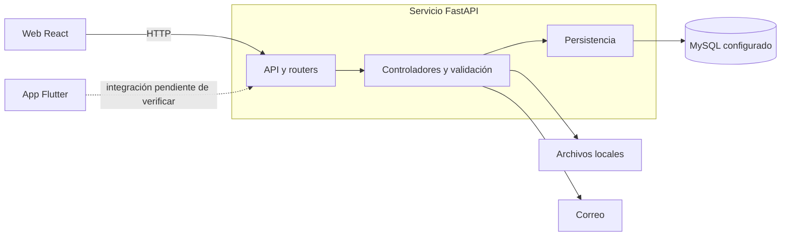

# Sustentación T6 — FOCCUS

Guía para preparar la exposición, no una calificación ni una aprobación. La decisión corresponde al equipo y al instructor o jurado.

## Navegación

- [Lista de los 15 puntos](#lista-de-los-15-puntos)
- [Evidencias y alcance](#evidencias-y-alcance)
- [Arquitectura y backend](#arquitectura-y-backend)
- [Recorrido de la demo](#recorrido-de-la-demo)
- [Pendientes y deuda priorizada](#pendientes-y-deuda-priorizada)
- [Fuentes y disponibilidad](#fuentes-y-disponibilidad)

## Lista de los 15 puntos

Los responsables se indican por asignación conocida: **compañero** para los puntos 2, 6, 7 y 14; **equipo** para los demás, sin adjudicar personas ni compromisos nuevos. «Avance» no significa que el criterio esté aprobado.

| # | Necesario según la lista | Responsable | Situación y evidencia | Falta |
|---|---|---|---|---|
| 1 | Cierre honesto de T6 y lo que pasaría a T7. | Equipo | Esta guía separa avances y pendientes. | Acordar qué se cierra y qué, si corresponde, se lleva a T7; no hay decisión documentada aquí. |
| 2 | Al menos dos sprints con retrospectivas que reflexionen sobre pruebas. | Compañero | Asignado; aquí no se ha verificado la evidencia. | Reunir y presentar las retrospectivas reales. |
| 3 | Cuarto backend funcional y responsabilidad diferenciada frente a los anteriores. | Equipo | Se observa un servicio FastAPI con varios módulos. El usuario explica que el proyecto usa un solo backend. | Consultar la interpretación al instructor, aportar los antecedentes reales y demostrar el arranque de lo que se exija; no se acreditan cuatro servicios. |
| 4 | Validación de entrada, JWT funcional e instalación desde cero con ejemplo de configuración. | Equipo | Las pruebas locales registradas ejercitan validación y JWT de forma aislada. | Verificar instalación limpia y funcionamiento en el entorno acordado; no publicar configuración sensible. |
| 5 | Arquitectura actualizada y demo integral del sistema. | Equipo | Hay un diagrama orientativo y un recorrido propuesto abajo. **Demo sin ejecutar.** | Ejecutar el flujo completo y registrar el resultado; comprobar móvil si forma parte de la exposición. |
| 6 | Bonificación IoT: prototipo, recepción de datos y protocolo. | Compañero | Asignado; es una bonificación, no un requisito obligatorio según la introducción de la lista. | Si se presenta, mostrar prototipo, comunicación y datos reales de prueba; no afirmar que existe sin evidencia. |
| 7 | Plan de pruebas: alcance, niveles y ambiente separado del desarrollo. | Compañero | Asignado; no se ha verificado un plan completo en esta revisión. | Preparar o aportar el plan y el ambiente separado. |
| 8 | Al menos 20 casos positivos y negativos, con datos, pasos y resultados esperados y obtenidos. | Equipo | El README local del producto registra **27 casos** aislados ejecutados; su matriz y pruebas no están publicadas en el commit base observado. | Publicar la evidencia autorizada y revisar con el responsable del plan si satisface el alcance exigido; los casos no prueban todo el sistema. |
| 9 | Pruebas automatizadas con al menos 50 % de cobertura de un módulo crítico y colección Postman con tests. | Equipo | En ejecución local se registró **93 % de sentencias de `auth.py`** y **7 solicitudes / 7 aserciones** exitosas contra API parcial simulada. | Hacer disponible la evidencia, justificar el módulo y acordar si el alcance satisface el criterio; completar lo que requiera la API real. |
| 10 | Reporte de ejecución y defectos registrados con severidad y estado. | Equipo | El README local describe entorno, versión y resultados parciales. | Consolidar reporte y registrar defectos reales en el sistema acordado, con severidad y estado; no se demuestra ese registro aquí. |
| 11 | Dos ciclos de detectar → corregir → verificar, con caso, commit y reejecución. | Equipo | La corrección del servidor de prueba Postman y su reejecución **no** constituyen un ciclo demostrado de defecto de producción con commit. | Demostrar dos ciclos reales completos, sin inventar defectos ni historial. |
| 12 | README con pruebas y documentación de la API del cuarto backend. | Equipo | Existe una sección de pruebas en el README **local** del producto; `/docs` y `/openapi.json` respondieron para la aplicación parcial de prueba, no para el servicio completo. | Publicar evidencia autorizada, documentar la API exigida y verificar instalación limpia y documentación del servicio completo. |
| 13 | Commits que distingan construcción y corrección, idealmente asociados a incidencias. | Equipo | El historial del producto contiene ejemplos de mensajes de construcción y de corrección. | Relacionar defectos reales, sus commits y verificaciones cuando existan; un prefijo por sí solo no prueba un ciclo. |
| 14 | Linter sin errores críticos y ausencia de regresiones respecto a T5. | Compañero | Una ejecución local de ESLint registró **14 errores**; no se comprobó su criticidad ni ausencia de regresiones. | Revisar y resolver los hallazgos aplicables y comprobar regresiones frente a T5. |
| 15 | Reflexión comparativa de los cuatro backends y deuda técnica priorizada. | Equipo | Hay reflexión sobre el servicio observado y una lista de deuda abajo. | Aclarar con el instructor qué se debe comparar y aportar antecedentes reales; no inventar cuatro implementaciones. |

## Evidencias y alcance

Resultados **registrados en el árbol local de FOCCUS**, en Windows, el 21-11-2026, sobre la base `9126d8f` con cambios locales sin commit. No se repitieron para preparar esta guía y no demuestran el estado de producción ni el de una instalación limpia.

| Evidencia local registrada | Resultado | Límite |
|---|---|---|
| Seguridad y permisos backend | 36 pruebas aprobadas: 27 casos nuevos y 9 pruebas existentes. | Son pruebas aisladas; usan simulaciones y SQLite en memoria, no prueban MySQL ni correo reales. |
| Cobertura | 108 de 116 sentencias de `auth.py`: **93 %**. | Solo sentencias de ese archivo; no ramas ni todo el backend. |
| Postman/Newman | **7 solicitudes y 7 aserciones aprobadas**. | Aplicación parcial con cuatro rutas de usuario y BD simulada; no prueba toda la API, login exitoso ni infraestructura real. |
| Frontend | 37 pruebas aprobadas y build finalizado. | Sin prueba en navegador ni verificación móvil. El build avisó de paquetes grandes. |
| Lint | 14 errores en la ejecución registrada. | No se demuestra ausencia de errores críticos o regresiones T5. |

La matriz de los 27 casos, su código de prueba, la colección y el detalle de la ejecución están en archivos **locales sin commit**. No están incluidos en esta publicación documental. Al hacerlos disponibles, revisar datos y configuración antes de cualquier publicación.

## Arquitectura y backend

Vista simplificada de la revisión local; no demuestra que todos los componentes estén integrados o ejecutándose:

La explicación del usuario es que FOCCUS usa **un solo backend**. El código revisado muestra un servicio con responsabilidades repartidas en routers; eso no demuestra cuatro backends independientes. Una API compartida facilita reutilizar controles, pero un cambio puede afectar varios módulos y clientes. La interpretación de «cuarto backend» y de la comparación de cuatro **está pendiente de confirmación por el instructor**.

## Recorrido de la demo

**Propuesta sin ejecutar.** Usar únicamente entorno autorizado y datos ficticios; no mostrar accesos ni información privada.

1. Confirmar las versiones instaladas y la disponibilidad de los componentes necesarios.
2. Iniciar sesión y completar 2FA cuando corresponda.
3. Abrir un proyecto ficticio y mostrar su guion y una escena.
4. Mostrar las relaciones disponibles con galería, desglose y rodaje.
5. Si el móvil fue verificado, consultar el mismo proyecto; en otro caso explicar que está pendiente.
6. Explicar el diagrama, las pruebas parciales y los faltantes.

Si una relación no está disponible, indicarlo; no presentar el recorrido como completo. El catálogo de bloques está bloqueado por la migración pendiente y no debe ser una dependencia de la demo.

## Pendientes y deuda priorizada

Prioridades orientativas, sin fechas ni compromisos acordados:

1. **Alta:** verificar instalación limpia, integración completa y demo; comprobar móvil y compatibilidad de login/2FA si se va a presentar.
2. **Alta:** completar el reporte de defectos y demostrar los dos ciclos reales de corrección.
3. **Alta:** catálogo de bloques bloqueado: migración sin aplicar; Docker está pausado. No realizar migraciones ni presentarlo como disponible.
4. **Media:** revisar los 14 errores de lint y la ausencia de regresiones T5 con el compañero responsable.
5. **Media:** evaluar recuperación de archivos almacenados localmente y mejorar el manejo compartido de errores HTTP.

El equipo y el instructor deben decidir qué queda para T7; esta lista no toma esa decisión.

## Fuentes y disponibilidad

**Disponibles en GitHub:**

- [Lista oficial de chequeo T6](https://github.com/ergrato-dev/checklist-proyectos-adso/blob/main/listas-de-chequeo/listas-oferta-abierta/t6/6t-lista-de-chequeo-oa.md): fuente de los 15 criterios y la bonificación IoT.
- [FOCCUS, README del commit base](https://github.com/Cr4ckJu4nF3/FOCCUS/blob/9126d8f/README.md): referencia pública del proyecto; la sección local «Pruebas y evidencia T6» no forma parte de ese commit.
- [Diagramas documentales del commit base](https://github.com/Aerxs666/FOCCUS-RF/blob/50b8bd5/diagramas/README.md): referencia existente; sus cambios locales de T6 no se incluyen en esta publicación.

**Consultadas solo en local, sin commit y no publicadas con esta guía:** sección «Pruebas y evidencia T6» del README de FOCCUS; investigación `docs/agentes/investigacion/2026-11-21-lista-chequeo-t6.md`; documentos de cierre, demo, API/commits y deuda T6 en `exposicion/`; y actualización del diagrama de arquitectura. Por ello no se enlazan como si ya estuvieran disponibles en GitHub. Su contenido puede cambiar antes de publicarse.
