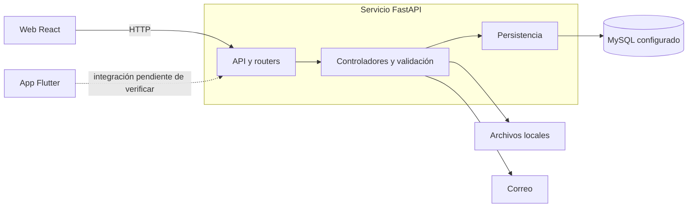

# Sustentación T6 — FOCCUS

Guía para preparar la exposición, no una calificación ni una aprobación del jurado. La decisión corresponde al instructor o jurado.

## Navegación

- [Lista de los 15 puntos](#lista-de-los-15-puntos)
- [Evidencia por requisito](#evidencia-por-requisito)
- [Arquitectura y backend](#arquitectura-y-backend)
- [Recorrido de la demo](#recorrido-de-la-demo)
- [Pendientes y deuda priorizada](#pendientes-y-deuda-priorizada)
- [Fuentes y disponibilidad](#fuentes-y-disponibilidad)

## Lista de los 15 puntos

✅ **Cumplido:** se encontró evidencia de todo el criterio. 🟡 **Parcial:** hay evidencia, pero no de todos sus componentes. — **Pendiente:** no se encontró evidencia suficiente. La bonificación IoT es opcional; «pendiente» no afirma que deba presentarse. Estos estados no sustituyen la evaluación del jurado.

| ID | Requisito de la lista T6 | Estado | Falta |
|---|---|---|---|
| [T6-01](#t6-01--cierre) | Cierre honesto de T6 y lo que pasaría a T7. | 🟡 Parcial | Acordar y documentar qué termina y qué pasa a T7. |
| [T6-02](#t6-02--retrospectivas) | Al menos dos sprints con retrospectivas sobre pruebas. | — Pendiente | Aportar las dos retrospectivas reales. |
| [T6-03](#t6-03--cuarto-backend) | Cuarto backend funcional con responsabilidad diferenciada. | 🟡 Parcial | Aclarar el criterio con el instructor, aportar antecedentes y demostrar lo exigido. |
| [T6-04](#t6-04--validación-jwt-e-instalación) | Validación de entrada, JWT funcional e instalación desde cero con ejemplo de configuración. | 🟡 Parcial | Verificar instalación limpia y funcionamiento integral. |
| [T6-05](#t6-05--arquitectura-y-demo) | Arquitectura actualizada y demo integral. | 🟡 Parcial | Comprobar el diagrama y ejecutar y registrar la demo completa. |
| [T6-06](#t6-06--bonificación-iot) | Bonificación IoT: prototipo, recepción de datos y protocolo. | — Pendiente | Si se presenta, demostrar prototipo, comunicación y recepción. |
| [T6-07](#t6-07--plan-de-pruebas) | Plan de pruebas con alcance, niveles y ambiente separado de desarrollo. | — Pendiente | Aportar el plan completo y el ambiente separado. |
| [T6-08](#t6-08--matriz-de-casos) | Al menos 20 casos positivos y negativos con datos, pasos y resultados esperados y obtenidos. | 🟡 Parcial | Hacer disponible la matriz autorizada y confirmar que su alcance y resultados satisfacen la lista. |
| [T6-09](#t6-09--automatización-y-postman) | Pruebas unitarias con al menos 50 % de cobertura de un módulo crítico y colección Postman con tests. | 🟡 Parcial | Hacer disponible la evidencia y confirmar si las pruebas aisladas y la API parcial satisfacen el alcance exigido. |
| [T6-10](#t6-10--reporte-y-defectos) | Reporte de ejecución y defectos registrados con severidad y estado. | 🟡 Parcial | Consolidar el reporte y documentar defectos reales en el sistema de seguimiento. |
| [T6-11](#t6-11--ciclos-de-corrección) | Dos ciclos detectar → corregir → verificar con caso, commit y reejecución. | — Pendiente | Demostrar dos ciclos completos y reales. |
| [T6-12](#t6-12--readme-y-api) | README con pruebas y API del cuarto backend documentada. | 🟡 Parcial | Publicar la evidencia autorizada, aclarar el backend exigido y verificar la documentación de la API completa. |
| [T6-13](#t6-13--historial-de-commits) | Commits que distingan construcción y corrección, idealmente asociados a incidencias. | ✅ Cumplido | La asociación con incidencias es deseable, no obligatoria; no se demuestra aquí. |
| [T6-14](#t6-14--lint-y-regresiones) | Linter sin errores críticos y sin regresiones respecto a T5. | 🟡 Parcial | Revisar los errores y verificar regresiones frente a T5. |
| [T6-15](#t6-15--comparación-y-deuda) | Reflexión comparativa de cuatro backends y deuda técnica priorizada. | 🟡 Parcial | Aclarar la comparación con el instructor y aportar antecedentes reales. |

## Evidencia por requisito

Las ejecuciones citadas se **registraron**, no se repitieron en esta revisión: Windows, 21-11-2026, base local de FOCCUS `9126d8f` con cambios sin commit. No demuestran producción ni instalación limpia. Los archivos locales no publicados se identifican por su ruta, sin enlaces que aparenten estar disponibles en GitHub. Un campo de evidencia vacío indica que no se encontró evidencia para ese punto.

### T6-01 — Cierre

**Evidencia:** esta guía distingue avances y [deuda priorizada](#pendientes-y-deuda-priorizada).

**Falta:** una decisión documentada sobre lo terminado en T6 y lo que pasaría a T7.

### T6-02 — Retrospectivas

**Evidencia:**

**Falta:** dos retrospectivas de sprints con reflexión explícita sobre pruebas.

### T6-03 — Cuarto backend

**Evidencia:** en el código local `backend/api_usuarios/app/main.py` se observa una aplicación FastAPI con routers para distintos módulos. Según la explicación del usuario, FOCCUS usa un solo backend.

**Falta:** confirmar con el instructor qué significa «cuarto backend», aportar antecedentes reales y demostrar el arranque y la responsabilidad exigidos. Los routers no demuestran cuatro servicios independientes.

### T6-04 — Validación, JWT e instalación

**Evidencia:** `backend/api_usuarios/app/utils/auth.py` implementa creación y verificación de JWT. El archivo local no publicado `backend/api_usuarios/tests/test_t6_seguridad_aislada.py` contiene pruebas de JWT y validación; el README local registra su ejecución aislada. Existe un archivo de ejemplo de configuración versionado.

**Falta:** demostrar la instalación desde cero y el funcionamiento integral en el entorno acordado. Las pruebas aisladas no verifican servicios reales.

### T6-05 — Arquitectura y demo

**Evidencia:** abajo hay un [diagrama orientativo](#arquitectura-y-backend) y un [recorrido propuesto](#recorrido-de-la-demo).

**Falta:** validar el diagrama contra el sistema integrado y ejecutar y registrar la demo completa; comprobar móvil si se incluye. El recorrido no se ha ejecutado.

### T6-06 — Bonificación IoT

**Evidencia:**

**Falta:** si se presenta esta bonificación, demostrar un prototipo funcional, que los datos llegan al sistema y explicar el protocolo.

### T6-07 — Plan de pruebas

**Evidencia:**

**Falta:** plan con alcance, niveles y ambiente de prueba separado del desarrollo.

### T6-08 — Matriz de casos

**Evidencia:** el README local no publicado de FOCCUS, sección «Pruebas y evidencia T6», registra 27 casos positivos y negativos de JWT, roles y validación, con datos ficticios, resultados esperados y estado obtenido. Cada paso remite al método `test_NN` correspondiente en `backend/api_usuarios/tests/test_t6_seguridad_aislada.py`, también local y sin commit.

**Falta:** hacer disponible la matriz autorizada y confirmar que el alcance aislado y la forma de registrar los resultados cumplen lo exigido. No demuestra pruebas de todo el sistema.

### T6-09 — Automatización y Postman

**Evidencia:** el README local registra 36 pruebas backend aprobadas, incluidas 27 nuevas, y cobertura de **108 de 116 sentencias (93 %) de `auth.py`**, elegido por sus controles de JWT, 2FA, roles y recursos. También registra **7 solicitudes y 7 aserciones** aprobadas con Newman. La colección `backend/api_usuarios/tests/FOCCUS_T6.postman_collection.json` y la aplicación `tests/postman_app_aislada.py` están solo en local, sin commit.

**Falta:** poner la evidencia autorizada a disposición y confirmar su alcance. La cobertura es de sentencias de un archivo, no de ramas ni del backend completo; Postman se ejecutó contra cuatro rutas de usuario con BD simulada, sin login exitoso ni infraestructura real.

### T6-10 — Reporte y defectos

**Evidencia:** el README local de FOCCUS registra fecha, entorno, versión base y resultados de pruebas parciales. También registra 37 pruebas frontend aprobadas y un build terminado, sin prueba en navegador ni verificación móvil.

**Falta:** consolidar el reporte y aportar registros de defectos reales en un sistema de seguimiento con severidad y estado.

### T6-11 — Ciclos de corrección

**Evidencia:**

**Falta:** dos defectos reales con detección, caso, commit de corrección y reejecución verificable. La corrección del servidor de prueba Postman no demuestra por sí sola un ciclo completo de defecto del producto.

### T6-12 — README y API

**Evidencia:** el README local no publicado de FOCCUS contiene una sección de pruebas. Según ese registro, `/docs` respondió y `/openapi.json` describió cuatro rutas de la aplicación parcial de prueba; no se verificó la documentación del servicio completo.

**Falta:** publicar la evidencia autorizada y documentar y verificar la API exigida tras aclarar la interpretación del cuarto backend.

### T6-13 — Historial de commits

**Evidencia:** el historial público distingue construcción en [`7ff5143` (`feat(web)`)](https://github.com/Cr4ckJu4nF3/FOCCUS/commit/7ff51433c5d85f577053f33636fd6c6d1483c2ac) y corrección en [`2397a2b` (`fix(web)`)](https://github.com/Cr4ckJu4nF3/FOCCUS/commit/2397a2b121bfe9367107a86a1d85ade52f5777c5). La lista considera deseable, no obligatoria, la referencia a incidencias.

**Límite:** los mensajes distinguen la intención de los cambios; no prueban por sí solos un ciclo de defecto y reejecución como el exigido en T6-11.

### T6-14 — Lint y regresiones

**Evidencia:** el README local registra una ejecución de ESLint con **14 errores**.

**Falta:** revisar su criticidad y resolver los hallazgos aplicables; verificar que no haya regresiones respecto a T5.

### T6-15 — Comparación y deuda

**Evidencia:** la sección [Arquitectura y backend](#arquitectura-y-backend) reflexiona sobre el servicio observado y la [deuda técnica](#pendientes-y-deuda-priorizada) está ordenada por prioridad.

**Falta:** aclarar con el instructor qué debe compararse y aportar antecedentes reales de los cuatro backends del programa. No se inventa una comparación.

## Arquitectura y backend

Vista simplificada de la revisión local; no demuestra que todos los componentes estén integrados o ejecutándose:

La explicación del usuario es que FOCCUS usa **un solo backend**. El código revisado muestra un servicio con responsabilidades repartidas en routers; eso no demuestra cuatro backends independientes. Una API compartida facilita reutilizar controles, pero un cambio puede afectar varios módulos y clientes. La interpretación de «cuarto backend» y de la comparación de cuatro **está pendiente de confirmación por el instructor**.

## Recorrido de la demo

**Propuesta sin ejecutar.** Usar únicamente entorno autorizado y datos ficticios; no mostrar accesos ni información privada.

1. Confirmar las versiones instaladas y la disponibilidad de los componentes necesarios.
2. Iniciar sesión y completar 2FA cuando corresponda.
3. Abrir un proyecto ficticio y mostrar su guion y una escena.
4. Mostrar las relaciones disponibles con galería, desglose y rodaje.
5. Si el móvil fue verificado, consultar el mismo proyecto; en otro caso explicar que está pendiente.
6. Explicar el diagrama, las pruebas parciales y los faltantes.

Si una relación no está disponible, indicarlo; no presentar el recorrido como completo. El catálogo de bloques está bloqueado por la migración pendiente y no debe ser una dependencia de la demo.

## Pendientes y deuda priorizada

Prioridades orientativas, sin fechas ni compromisos acordados:

1. **Alta:** verificar instalación limpia, integración completa y demo; comprobar móvil y compatibilidad de login/2FA si se va a presentar.
2. **Alta:** completar el reporte de defectos y demostrar los dos ciclos reales de corrección.
3. **Alta:** catálogo de bloques bloqueado: migración sin aplicar; Docker está pausado. No realizar migraciones ni presentarlo como disponible.
4. **Media:** revisar los 14 errores de lint y la ausencia de regresiones T5.
5. **Media:** evaluar recuperación de archivos almacenados localmente y mejorar el manejo compartido de errores HTTP.

El equipo y el instructor deben decidir qué queda para T7; esta lista no toma esa decisión.

## Fuentes y disponibilidad

**Disponibles en GitHub:**

- [Lista oficial de chequeo T6](https://github.com/ergrato-dev/checklist-proyectos-adso/blob/main/listas-de-chequeo/listas-oferta-abierta/t6/6t-lista-de-chequeo-oa.md): fuente de los 15 criterios y la bonificación IoT.
- [FOCCUS, README del commit base](https://github.com/Cr4ckJu4nF3/FOCCUS/blob/9126d8f/README.md): referencia pública del proyecto; la sección local «Pruebas y evidencia T6» no forma parte de ese commit.
- [Diagramas documentales del commit base](https://github.com/Aerxs666/FOCCUS-RF/blob/50b8bd5/diagramas/README.md): referencia existente; sus cambios locales de T6 no se incluyen en esta publicación.

**Consultadas solo en local, sin commit y no publicadas con esta guía:** sección «Pruebas y evidencia T6» del README de FOCCUS; investigación `docs/agentes/investigacion/2026-11-21-lista-chequeo-t6.md`; documentos de cierre, demo, API/commits y deuda T6 en `exposicion/`; y actualización del diagrama de arquitectura. Por ello no se enlazan como si ya estuvieran disponibles en GitHub. Su contenido puede cambiar antes de publicarse.
