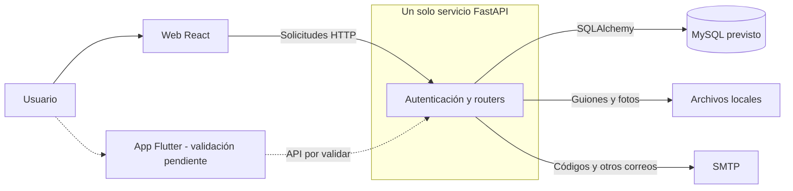
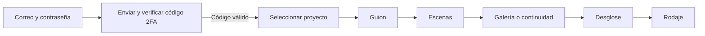

# Sustentación T6 — FOCCUS

Resumen del equipo para preparar la exposición; la calificación corresponde al instructor. Las pruebas registradas son parciales: no se ha demostrado una demo completa de inicio a fin.

## Matriz de estado y evidencia

| # | Criterio | Estado | Evidencia breve y qué falta |
|---|---|---|---|
| 01 | Cierre T6 y orientación T7 | ✅ | Cierre del desarrollo web; las pantallas de [guion](https://github.com/Cr4ckJu4nF3/FOCCUS/blob/02ffb2de7c123b5b228aa2e2df9298faf4278eca/frontend/src/screen/Guion.jsx) y [proyecto](https://github.com/Cr4ckJu4nF3/FOCCUS/blob/02ffb2de7c123b5b228aa2e2df9298faf4278eca/frontend/src/screen/ProjectDashboard.jsx) muestran módulos, no una demo completa. Móvil continúa pendiente. |
| 02 | Retrospectivas | ⏸ En proceso | Faltan dos retrospectivas reales con reflexión sobre las pruebas. |
| 03 | Backend funcional y responsabilidades | ✅ | FOCCUS utiliza **un servicio FastAPI** y organiza sus funciones en routers (usuarios, proyectos, guion, escenas, galería y rodaje). El [arranque probado](https://github.com/Cr4ckJu4nF3/FOCCUS/blob/docs/t6-evidencia-20261121/docs/agentes/T6_EVIDENCIA.md#ejecución-y-límites) fue simulado. La interpretación del criterio la valida el instructor. |
| 04 | JWT, validación e instalación | ✅ | El equipo confirma instalación desde cero, JWT y validación el 22-11-2026. La instalación no fue verificada independientemente por el agente; [pruebas aisladas y comandos](#comandos-para-repetir-las-pruebas). |
| 05 | Arquitectura y recorrido integral | 🟡 Parcial | [Diagramas y rutas](#evidencia-requisito-5); la demo completa con API y persistencia no está probada. |
| 06 | Bonificación IoT | ➖ No se realiza | Decisión del equipo; no se presenta un prototipo. |
| 07 | Plan de pruebas | ✅ | [Plan aprobado por el usuario](plan-pruebas.md); aprobar el plan no significa que se hayan ejecutado todos los casos. |
| 08 | Casos de prueba | ✅ | 27 casos de seguridad y 9 de API registrados en la [evidencia pública](https://github.com/Cr4ckJu4nF3/FOCCUS/blob/docs/t6-evidencia-20261121/docs/agentes/T6_EVIDENCIA.md#matriz-complementaria-de-api-integrada). |
| 09 | Automatización y cobertura | ✅ | 93 % de sentencias de `auth.py`; Newman: 7/7 aserciones en una API parcial. No representa cobertura integral del producto. |
| 10 | Reporte y seguimiento de defectos | ✅ Reporte y registro en archivo | [Reporte de ejecución](https://github.com/Cr4ckJu4nF3/FOCCUS/blob/docs/t6-evidencia-20261121/docs/agentes/T6_EVIDENCIA.md) y [registro persistente](seguimiento-defectos.md) con dos defectos reproducibles y corregidos en ramas separadas, aún no integradas. Confirmar con el instructor si acepta el seguimiento en archivo; esto no representa su aprobación. No se afirma que se hayan creado GitHub Issues. |
| 11 | Ciclos de corrección | ✅ | Dos ciclos publicados: [A](https://github.com/Cr4ckJu4nF3/FOCCUS/blob/fix/t6-ciclo-a/docs/agentes/T6_CICLO_IE.md) y [B](https://github.com/Cr4ckJu4nF3/FOCCUS/blob/fix/t6-ciclo-b/docs/agentes/T6_CICLO_LUGARES.md). Ramas separadas, aún no integradas en `main`. |
| 12 | README y documentación de API | ✅ | El [README](https://github.com/Cr4ckJu4nF3/FOCCUS/tree/docs/t6-evidencia-20261121#pruebas-y-evidencia-t6) describe módulos y rutas; `/openapi.json` respondió 200 y documentó 69 rutas en un arranque simulado. El agente no verificó instalación limpia ni infraestructura real. |
| 13 | Historial de construcción y corrección | ✅ | Hay commits de tipo [`feat`](https://github.com/Cr4ckJu4nF3/FOCCUS/commit/7ff51433c5d85f577053f33636fd6c6d1483c2ac) y [`fix`](https://github.com/Cr4ckJu4nF3/FOCCUS/commit/2397a2b121bfe9367107a86a1d85ade52f5777c5). No se demuestra vínculo con issues. |
| 14 | Linter y regresiones T5 | ➖ No se realiza | Decisión del equipo. No se afirma una exención oficial ni que el criterio esté aprobado. |
| 15 | Comparación de backends y deuda | ⏸ Pausado | La comparación queda pendiente; la deuda técnica está anotada en la [evidencia T6](https://github.com/Cr4ckJu4nF3/FOCCUS/blob/docs/t6-evidencia-20261121/docs/agentes/T6_EVIDENCIA.md). |

**Estados:** ✅ evidencia o confirmación del equipo según se indique; 🟡 parcial; ⏸ pendiente o pausado; ➖ el equipo decidió no realizarlo. No son calificaciones oficiales.

## Comandos para repetir las pruebas

Usar la rama publicada `docs/t6-evidencia-20261121`, abrir `backend/api_usuarios` y utilizar un entorno Python con las dependencias instaladas. Estos comandos no hacen una instalación limpia: las pruebas usan datos ficticios y dobles de prueba, sin conectarse a MySQL real ni leer `.env`.

**27 pruebas de JWT y validación:**

```text
python -B -m unittest -v tests.test_t6_seguridad_aislada
```

**Arranque aislado de FastAPI:**

```text
python -B -m unittest -v tests.test_t6_arranque_aislado
```

**Las 36 pruebas y cobertura de sentencias** (requiere `coverage` ya disponible en el entorno):

```text
python -m coverage run --source=app.utils.auth -m unittest -v tests.test_t6_seguridad_aislada tests.test_project_resource_ownership tests.test_projects_client_permissions
python -m coverage report -m
```

**Newman, API parcial local** (desde `backend/api_usuarios`, con Newman disponible; terminales separadas):

```text
# Terminal 1
python -m uvicorn tests.postman_app_aislada:app --host 127.0.0.1 --port 8765 --no-access-log

# Terminal 2
newman run tests/FOCCUS_T6.postman_collection.json --env-var baseUrl=http://127.0.0.1:8765 --reporters cli
```

El resultado registrado fue 36 pruebas aprobadas, 93 % de sentencias y 7/7 aserciones de Newman. El arranque simulado no comprueba MySQL, SMTP ni una instalación desde cero. La [evidencia publicada](https://github.com/Cr4ckJu4nF3/FOCCUS/blob/docs/t6-evidencia-20261121/docs/agentes/T6_EVIDENCIA.md#verificación-complementaria-22-11-2026) documenta un entorno virtual nuevo y la instalación de dependencias, no una instalación completa. La confirmación del equipo es independiente de esa prueba y no fue verificada por el agente.

## Evidencia requisito 5

### Arquitectura

El código reúne los routers en un solo servicio FastAPI. React es el cliente web; la integración móvil con la API queda pendiente de validar.

<!-- mermaid-checked: no \n, no em-dash/en-dash, no {} in labels, subgraphs are id["label"], arrows are -->|"label"|, all subgraphs closed by end, ids unique -->


1. **Presentación:** el usuario navega por [rutas y pantallas React](https://github.com/Cr4ckJu4nF3/FOCCUS/blob/02ffb2de7c123b5b228aa2e2df9298faf4278eca/frontend/src/routes.jsx); [api.js](https://github.com/Cr4ckJu4nF3/FOCCUS/blob/02ffb2de7c123b5b228aa2e2df9298faf4278eca/frontend/src/api.js) prepara solicitudes y añade el JWT cuando hay sesión.
2. **Servicio y seguridad:** [main.py](https://github.com/Cr4ckJu4nF3/FOCCUS/blob/02ffb2de7c123b5b228aa2e2df9298faf4278eca/backend/api_usuarios/app/main.py) reúne los routers; [auth.py](https://github.com/Cr4ckJu4nF3/FOCCUS/blob/02ffb2de7c123b5b228aa2e2df9298faf4278eca/backend/api_usuarios/app/utils/auth.py) valida el token en rutas protegidas.
3. **Datos:** [database.py](https://github.com/Cr4ckJu4nF3/FOCCUS/blob/02ffb2de7c123b5b228aa2e2df9298faf4278eca/backend/api_usuarios/app/config/database.py) configura SQLAlchemy; MySQL es la infraestructura prevista, no probada por el arranque simulado.
4. **Archivos y correo:** [file_storage.py](https://github.com/Cr4ckJu4nF3/FOCCUS/blob/02ffb2de7c123b5b228aa2e2df9298faf4278eca/backend/api_usuarios/app/utils/file_storage.py) maneja archivos locales y [mail.py](https://github.com/Cr4ckJu4nF3/FOCCUS/blob/02ffb2de7c123b5b228aa2e2df9298faf4278eca/backend/api_usuarios/app/utils/mail.py) envía correos por SMTP.

### Flujo end-to-end de ejemplo

La app web tiene rutas para [login, verificación y módulos](https://github.com/Cr4ckJu4nF3/FOCCUS/blob/02ffb2de7c123b5b228aa2e2df9298faf4278eca/frontend/src/routes.jsx). Este recorrido es una **visita de ejemplo**, no una secuencia obligatoria entre módulos ni evidencia de que se haya hecho una demo integral:

<!-- mermaid-checked: no \n, no em-dash/en-dash, no {} in labels, subgraphs are id["label"], arrows are -->|"label"|, all subgraphs closed by end, ids unique -->


1. **Acceso y 2FA:** [Login.jsx](https://github.com/Cr4ckJu4nF3/FOCCUS/blob/02ffb2de7c123b5b228aa2e2df9298faf4278eca/frontend/src/screen/Login.jsx) solicita el acceso y el envío del código; [TwoFactor.jsx](https://github.com/Cr4ckJu4nF3/FOCCUS/blob/02ffb2de7c123b5b228aa2e2df9298faf4278eca/frontend/src/screen/TwoFactor.jsx) lo verifica. Las [rutas](https://github.com/Cr4ckJu4nF3/FOCCUS/blob/02ffb2de7c123b5b228aa2e2df9298faf4278eca/backend/api_usuarios/app/routes/user_routes.py) y el [controlador](https://github.com/Cr4ckJu4nF3/FOCCUS/blob/02ffb2de7c123b5b228aa2e2df9298faf4278eca/backend/api_usuarios/app/controllers/user_controller.py) exigen 2FA en cada nuevo login exitoso y entregan el token tras verificar el código.
2. **Proyecto:** [ProjectSelection.jsx](https://github.com/Cr4ckJu4nF3/FOCCUS/blob/02ffb2de7c123b5b228aa2e2df9298faf4278eca/frontend/src/screen/ProjectSelection.jsx) permite escoger un proyecto; las [rutas de proyecto](https://github.com/Cr4ckJu4nF3/FOCCUS/blob/02ffb2de7c123b5b228aa2e2df9298faf4278eca/backend/api_usuarios/app/routes/project_routes.py) atienden las operaciones correspondientes.
3. **Guion y escenas:** las pantallas de [guion](https://github.com/Cr4ckJu4nF3/FOCCUS/blob/02ffb2de7c123b5b228aa2e2df9298faf4278eca/frontend/src/screen/Guion.jsx) y [escenas](https://github.com/Cr4ckJu4nF3/FOCCUS/blob/02ffb2de7c123b5b228aa2e2df9298faf4278eca/frontend/src/screen/Escena.jsx) se apoyan en sus rutas de [guion](https://github.com/Cr4ckJu4nF3/FOCCUS/blob/02ffb2de7c123b5b228aa2e2df9298faf4278eca/backend/api_usuarios/app/routes/guion_routes.py) y [escenas](https://github.com/Cr4ckJu4nF3/FOCCUS/blob/02ffb2de7c123b5b228aa2e2df9298faf4278eca/backend/api_usuarios/app/routes/escena_routes.py).
4. **Galería y continuidad:** [Galeria.jsx](https://github.com/Cr4ckJu4nF3/FOCCUS/blob/02ffb2de7c123b5b228aa2e2df9298faf4278eca/frontend/src/screen/Galeria.jsx) muestra recursos del proyecto; el backend organiza las rutas de [galería](https://github.com/Cr4ckJu4nF3/FOCCUS/blob/02ffb2de7c123b5b228aa2e2df9298faf4278eca/backend/api_usuarios/app/routes/galeria_routes.py) y [continuidad](https://github.com/Cr4ckJu4nF3/FOCCUS/blob/02ffb2de7c123b5b228aa2e2df9298faf4278eca/backend/api_usuarios/app/routes/continuidad_routes.py).
5. **Desglose y rodaje:** [Desglose.jsx](https://github.com/Cr4ckJu4nF3/FOCCUS/blob/02ffb2de7c123b5b228aa2e2df9298faf4278eca/frontend/src/screen/Desglose.jsx) consulta el desglose y [Rodaje.jsx](https://github.com/Cr4ckJu4nF3/FOCCUS/blob/02ffb2de7c123b5b228aa2e2df9298faf4278eca/frontend/src/screen/Rodaje.jsx) gestiona rodajes; sus rutas están en [desglose](https://github.com/Cr4ckJu4nF3/FOCCUS/blob/02ffb2de7c123b5b228aa2e2df9298faf4278eca/backend/api_usuarios/app/routes/desglose_routes.py) y [rodaje](https://github.com/Cr4ckJu4nF3/FOCCUS/blob/02ffb2de7c123b5b228aa2e2df9298faf4278eca/backend/api_usuarios/app/routes/rodaje_routes.py).

**Alcance del 2FA:** no se encontró una excepción para dispositivos recordados. «Recordarme» afecta la duración y el almacenamiento de la sesión verificada; si esta sigue vigente, se puede reutilizar sin iniciar sesión de nuevo. Los tests ejecutados sustituyeron servicios reales; el diagrama no prueba persistencia ni una demo completa.

## Referencias

- [Plan de pruebas T6](plan-pruebas.md).
- [Evidencia T6 publicada en FOCCUS](https://github.com/Cr4ckJu4nF3/FOCCUS/blob/docs/t6-evidencia-20261121/docs/agentes/T6_EVIDENCIA.md).
- [Registro persistente de seguimiento de defectos](seguimiento-defectos.md).
- [README de la rama de evidencia](https://github.com/Cr4ckJu4nF3/FOCCUS/tree/docs/t6-evidencia-20261121).
- [Ciclo A](https://github.com/Cr4ckJu4nF3/FOCCUS/blob/fix/t6-ciclo-a/docs/agentes/T6_CICLO_IE.md) y [ciclo B](https://github.com/Cr4ckJu4nF3/FOCCUS/blob/fix/t6-ciclo-b/docs/agentes/T6_CICLO_LUGARES.md); ramas distintas, aún no integradas.
