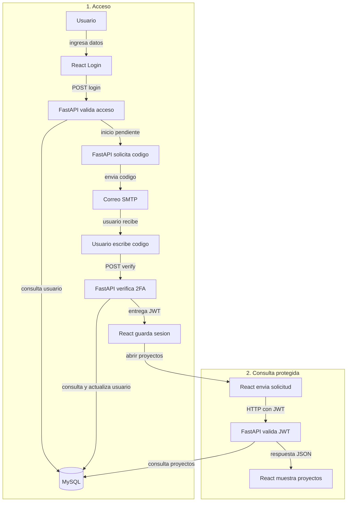
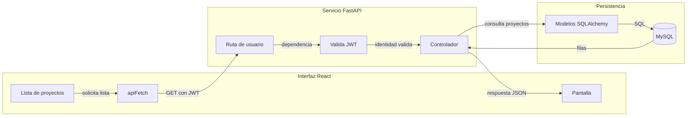

# Backend y recorrido end-to-end

Guía para explicar FOCCUS en la sustentación. Se confirmó que el backend arranca; este documento describe el código, no una nueva prueba integral.

## Requisito 3: encender y explicar el backend

FOCCUS tiene **un servicio FastAPI**, organizado en routers, no cuatro servicios independientes.

| Responsabilidad | Ejemplos |
|---|---|
| Acceso y seguridad | Validar datos, login, 2FA y JWT. |
| Proyectos y personas | Usuarios, clientes, roles y proyectos. |
| Producción audiovisual | Guion, escenas, galería, continuidad, desglose y rodaje. |
| Persistencia e integración | Consultar MySQL, gestionar archivos y enviar correos. |

[main.py](https://github.com/Cr4ckJu4nF3/FOCCUS/blob/cc96590fcb5ce8e1c063110c0b3beb6ecbe89e25/backend/api_usuarios/app/main.py) reúne los routers. La lista original también pide justificar la diferencia frente a backends anteriores; el instructor debe aclarar cómo aplica al proyecto.

### Arranque en PowerShell

Desde la raíz del repositorio `FOCCUS`, con el entorno `.venv`, las dependencias y la configuración privada ya preparados:

```powershell
Set-Location .\backend\api_usuarios
.\.venv\Scripts\python.exe -m uvicorn app.main:app --reload
```

Abrir `http://127.0.0.1:8000/docs` para mostrar las rutas; detener con `Ctrl+C`. Si falta el entorno o alguna dependencia, seguir la [instalación del README de FOCCUS](https://github.com/Cr4ckJu4nF3/FOCCUS/blob/cc96590fcb5ce8e1c063110c0b3beb6ecbe89e25/README.md#instalación--backend). No mostrar ni publicar configuración privada.

**Precaución:** el arranque se conecta a la base configurada y `main.py` ejecuta `Base.metadata.create_all`; puede crear tablas faltantes. Usar solo un ambiente autorizado. Abrir `/docs` no demuestra por sí solo todos los flujos.

## Recorrido de acceso y consulta de proyectos

Ejemplo: usuario con cuenta activa y rol distinto de administrador. Después de verificar el código, abre la lista de sus proyectos. Los nombres de las rutas son los del código, no datos reales.

### Vista general

<!-- mermaid-checked: no \n, no em-dash/en-dash, no {} in labels, subgraphs are id["label"], arrows are -->|"label"|, all subgraphs closed by end, ids unique -->


| Parte | Tecnología | Función |
|---|---|---|
| Interfaz | React 19 y Vite | Recibe las acciones y muestra la respuesta. |
| API | FastAPI y Uvicorn | Recibe HTTP y ejecuta rutas y controladores. |
| Datos | SQLAlchemy y MySQL | Consulta usuarios y proyectos. |
| Correo | SMTP | Envía el código de verificación. |

El login exitoso inicia un intento pendiente; **el JWT de acceso se entrega después de verificar 2FA**. Una sesión ya verificada puede seguir usándose mientras sea válida; «recordarme» no elimina el 2FA de un nuevo login.

### Paso a paso con código

1. **Login:** [Login.jsx](https://github.com/Cr4ckJu4nF3/FOCCUS/blob/cc96590fcb5ce8e1c063110c0b3beb6ecbe89e25/frontend/src/screen/Login.jsx) envía `POST /users/login`. La ruta en [user_routes.py](https://github.com/Cr4ckJu4nF3/FOCCUS/blob/cc96590fcb5ce8e1c063110c0b3beb6ecbe89e25/backend/api_usuarios/app/routes/user_routes.py) llama a `login_user`, que consulta el usuario y comprueba la contraseña en [user_controller.py](https://github.com/Cr4ckJu4nF3/FOCCUS/blob/cc96590fcb5ce8e1c063110c0b3beb6ecbe89e25/backend/api_usuarios/app/controllers/user_controller.py).
2. **Código:** el frontend llama a `POST /users/2fa/check` y después a `POST /users/2fa/send`. [TwoFactor.jsx](https://github.com/Cr4ckJu4nF3/FOCCUS/blob/cc96590fcb5ce8e1c063110c0b3beb6ecbe89e25/frontend/src/screen/TwoFactor.jsx) envía el código a `POST /users/2fa/verify`. El controlador verifica el intento, actualiza el último acceso y genera el JWT. React lo guarda con `setToken`.
3. **Proyectos:** [ProjectSelection.jsx](https://github.com/Cr4ckJu4nF3/FOCCUS/blob/cc96590fcb5ce8e1c063110c0b3beb6ecbe89e25/frontend/src/screen/ProjectSelection.jsx) solicita `GET /users/{id_user}/projects` al abrir la lista. [api.js](https://github.com/Cr4ckJu4nF3/FOCCUS/blob/cc96590fcb5ce8e1c063110c0b3beb6ecbe89e25/frontend/src/api.js) adjunta el JWT. La ruta verifica el token y que el ID solicitado sea el del usuario; el controlador consulta sus proyectos y devuelve JSON para mostrarlos.

### Detalle de la consulta protegida

<!-- mermaid-checked: no \n, no em-dash/en-dash, no {} in labels, subgraphs are id["label"], arrows are -->|"label"|, all subgraphs closed by end, ids unique -->


| Componente | Código | Responsabilidad |
|---|---|---|
| Pantalla y cliente | [ProjectSelection.jsx](https://github.com/Cr4ckJu4nF3/FOCCUS/blob/cc96590fcb5ce8e1c063110c0b3beb6ecbe89e25/frontend/src/screen/ProjectSelection.jsx), [api.js](https://github.com/Cr4ckJu4nF3/FOCCUS/blob/cc96590fcb5ce8e1c063110c0b3beb6ecbe89e25/frontend/src/api.js) | Solicitar y mostrar los proyectos. |
| Ruta y seguridad | [user_routes.py](https://github.com/Cr4ckJu4nF3/FOCCUS/blob/cc96590fcb5ce8e1c063110c0b3beb6ecbe89e25/backend/api_usuarios/app/routes/user_routes.py), [auth.py](https://github.com/Cr4ckJu4nF3/FOCCUS/blob/cc96590fcb5ce8e1c063110c0b3beb6ecbe89e25/backend/api_usuarios/app/utils/auth.py) | Validar JWT y limitar la consulta al propio usuario. |
| Controlador y modelos | [user_controller.py](https://github.com/Cr4ckJu4nF3/FOCCUS/blob/cc96590fcb5ce8e1c063110c0b3beb6ecbe89e25/backend/api_usuarios/app/controllers/user_controller.py), [Project](https://github.com/Cr4ckJu4nF3/FOCCUS/blob/cc96590fcb5ce8e1c063110c0b3beb6ecbe89e25/backend/api_usuarios/app/models/project_model.py), [UserProject](https://github.com/Cr4ckJu4nF3/FOCCUS/blob/cc96590fcb5ce8e1c063110c0b3beb6ecbe89e25/backend/api_usuarios/app/models/user_project_model.py) | Consultar proyectos vinculados al usuario. |

**Fragmentos reales**, abreviados sin datos ni tokens:

```javascript
// TwoFactor.jsx: después de recibir la verificación exitosa
setToken(data.access_token, Boolean(location.state?.rememberMe));
```

```javascript
// ProjectSelection.jsx
const response = await apiFetch(`/users/${idUser}/projects`);
```

```javascript
// api.js: añade el JWT si hay sesión
...(token ? { Authorization: `Bearer ${token}` } : {}),
```

```python
# user_routes.py
@router.get("/users/{id_user}/projects")
def user_projects(
    id_user: int,
    db: Session = Depends(get_db),
    current_user: dict = Depends(get_current_user)
):
    if id_user != current_user["id_user"]:
        raise HTTPException(
            status_code=status.HTTP_403_FORBIDDEN,
            detail="Solo puedes consultar tus propios proyectos",
        )
    return get_user_projects(id_user, db)
```

```python
# user_controller.py
projects = db.query(Project, UserProject.id_rol).join(
    UserProject, Project.id_project == UserProject.id_project
).filter(UserProject.id_user == id_user).all()
```

La respuesta se guarda en el estado de React y se muestra como lista. Este ejemplo es de **lectura**: no muestra creación de proyecto ni los flujos de guion, galería, rodaje o móvil. Para administradores y cuentas pendientes hay otros destinos tras 2FA. El diagrama explica el código; no prueba que se haya ejecutado todo el recorrido.
